# Лабораторная работа №2. Сайт научных конференций

**Дисциплина:** WEB-программирование  
**Выполнил:** Криличевский Максим, группа K3339  
**Вариант:** №5 — «Список научных конференций»  
**Дата проверки:** 31 октября 2026 года

## Цель работы

Освоить создание веб-приложения средствами Django: описать модель данных, реализовать формы и представления, подключить PostgreSQL, настроить авторизацию и разграничение доступа, вывести информацию через HTML-шаблоны.

## Задание варианта №5

Разработать сайт, на котором представлены названия и тематики конференций, место и период проведения, описание конференции и места проведения, условия участия. Реализовать регистрацию пользователей, подачу, изменение и удаление собственных заявок на выступление, отзывы с оценкой от 1 до 10 и датами конференции. Предусмотреть управление результатами выступлений администратором и общую таблицу участников по конференциям.

Дополнительно реализованы CSS-оформление, поиск, пагинация и различие действий администратора и обычного пользователя в интерфейсе сайта.

Источник задания: [методичка ЛР2, вариант №5](https://github.com/rendex85/ITMO_ICT_WebDevelopment_Docs/blob/fb91ff2584b07a0d80abe0ef2a8bc4869100ec90/docs/lab2/assignment.md). В данном отчёте описано приложение варианта №5.

## Используемые средства и структура проекта

Приложение написано на Python с использованием Django 6.1.2. Рабочая база данных — PostgreSQL. Шаблоны обрабатываются встроенным движком **DjangoTemplates**; оформление выполнено собственным CSS. Отчёт оформлен в MkDocs с темой Material.

Расположение проекта в репозитории:

```text
students/K3339/laboratory_works/Krilichevskiy_Maxim/
└── laboratory_work_2/django_lab2/
    └── conferences_webapp/
        ├── manage.py
        ├── conferences_webapp/
        │   ├── settings.py
        │   └── urls.py
        └── conferences/
            ├── models.py
            ├── forms.py
            ├── views.py
            ├── urls.py
            ├── admin.py
            ├── tests.py
            ├── migrations/
            ├── templates/conferences/
            └── static/conferences/style.css
```

В архитектуре Django модель описывает данные, представление обрабатывает запрос и выполняет прикладную логику, шаблон формирует HTML-страницу. Маршруты в `urls.py` связывают адреса с обработчиками. Работа с PostgreSQL выполняется через ORM Django.

## Модель данных

Используется стандартный пользователь Django и три модели приложения.

### Conference — конференция

| Поле | Назначение |
|---|---|
| `title` | Название конференции |
| `location` | Место проведения |
| `start_date`, `end_date` | Даты начала и окончания |
| `topic` | Тематики в текстовом виде; несколько значений вводятся через запятую |
| `description` | Описание конференции |
| `venue_description` | Описание места проведения |
| `participation_terms` | Условия участия |

Тематики хранятся одной строкой, а не отдельным справочником. Поиск учитывает содержимое этого поля.

### Registration — заявка на выступление

| Поле | Назначение |
|---|---|
| `user` | Пользователь, подавший заявку |
| `conference` | Конференция, на которую подана заявка |
| `presentation_title` | Название доклада |
| `description` | Описание доклада |
| `recommended` | Результат: рекомендован к публикации или не рекомендован |

Один пользователь может подать несколько заявок, одна конференция может иметь много заявок. Промежуточные записи `Registration` связывают пользователей и конференции и содержат сведения об их выступлениях. Внешние ключи настроены с `on_delete=models.CASCADE`.

Булево поле результата содержит два состояния. Отдельный статус «ещё не рассмотрено» в текущей модели не предусмотрен.

### Review — отзыв

| Поле | Назначение |
|---|---|
| `user`, `conference` | Автор отзыва и конференция |
| `text` | Текст отзыва |
| `rating` | Оценка с валидаторами диапазона 1–10 |
| `conference_start_date`, `conference_end_date` | Даты конференции на момент создания отзыва |
| `created_at` | Дата и время создания отзыва |

Метод `Review.save()` при первом сохранении копирует даты конференции. При последующем изменении текста отзыва или переносе конференции сохранённый период не обновляется. Поля дат имеют `editable=False` и не запрашиваются в пользовательской форме.

Миграция `0005_review_conference_dates` сначала добавляет поля с возможностью пустого значения, затем заполняет существующие отзывы и устанавливает обязательность полей. Для прежних отзывов берутся **текущие даты** конференций: исходные исторические значения до появления снимка отдельно не хранились.

## Формы и обработка запросов

| Форма | Реализация | Поля пользователя |
|---|---|---|
| Регистрация аккаунта | `RegisterForm`, наследник `UserCreationForm` | Имя пользователя и два поля пароля |
| Заявка на доклад | `RegistrationForm`, наследник `ModelForm` | Название и описание доклада |
| Отзыв | `ReviewForm`, наследник `ModelForm` | Текст и оценка |

При GET-запросе обработчик отображает форму. При POST создаёт форму на основе присланных данных, вызывает `is_valid()` и сохраняет запись при отсутствии ошибок. После успешного сохранения выполняется перенаправление на страницу конференции или каталог.

При создании заявки используется `form.save(commit=False)`: автор и конференция присваиваются сервером до записи в БД. Поле `recommended` в пользовательскую форму не включено. Аналогично сервер задаёт автора отзыва, а модель автоматически сохраняет даты конференции.

## Реализованные интерфейсы

Снимки сделаны 31 октября 2026 года с работающего локального сайта. Кадры личных заявок и административных действий получены после входа под учётной записью `max`. При съёмке формы не отправлялись и записи не изменялись.

### Каталог конференций

Адрес: `/conferences/`. Представление `conference_list` выводит карточки с названием, местом и датами. Строка поиска фильтрует конференции по названию, тематике или месту. Условия объединены оператором OR с помощью `Q`.

`Paginator` разбивает результат поиска на страницы по 10 конференций. Сортировка по `start_date` и `pk` обеспечивает определённый порядок. Ссылки переключения страниц сохраняют поисковый запрос `q`.

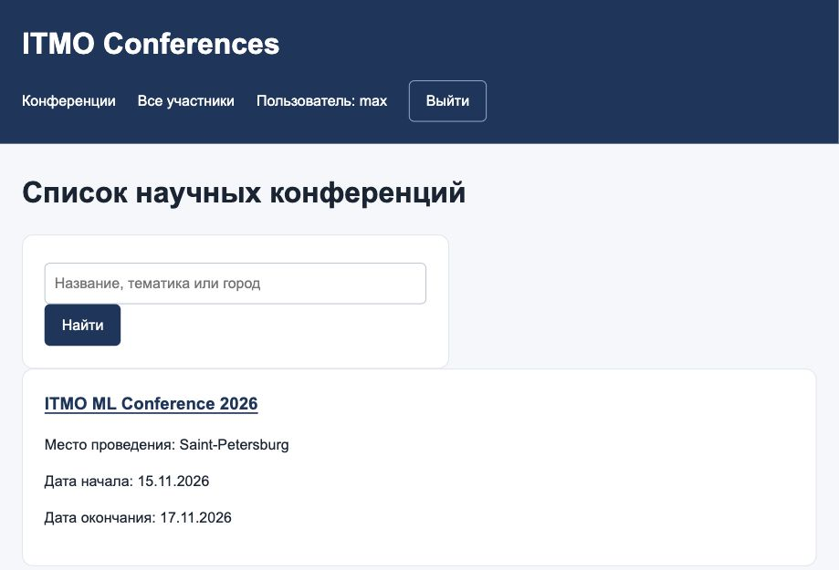

*Рисунок 1. Каталог научных конференций и строка поиска.*

### Страница конференции

Адрес: `/conferences/<id>/`. Представление `conference_detail` выводит все описательные поля, личные заявки текущего пользователя, таблицу выступлений и отзывы. При отсутствии конференции возвращается ответ 404.

В интерфейсе выделены отдельные разделы: сведения о конференции, «Мои заявки», «Участники конференции» и «Отзывы о конференции». Действия оформлены кнопками, результаты — цветными отметками. Таблица допускает горизонтальную прокрутку на узких экранах.

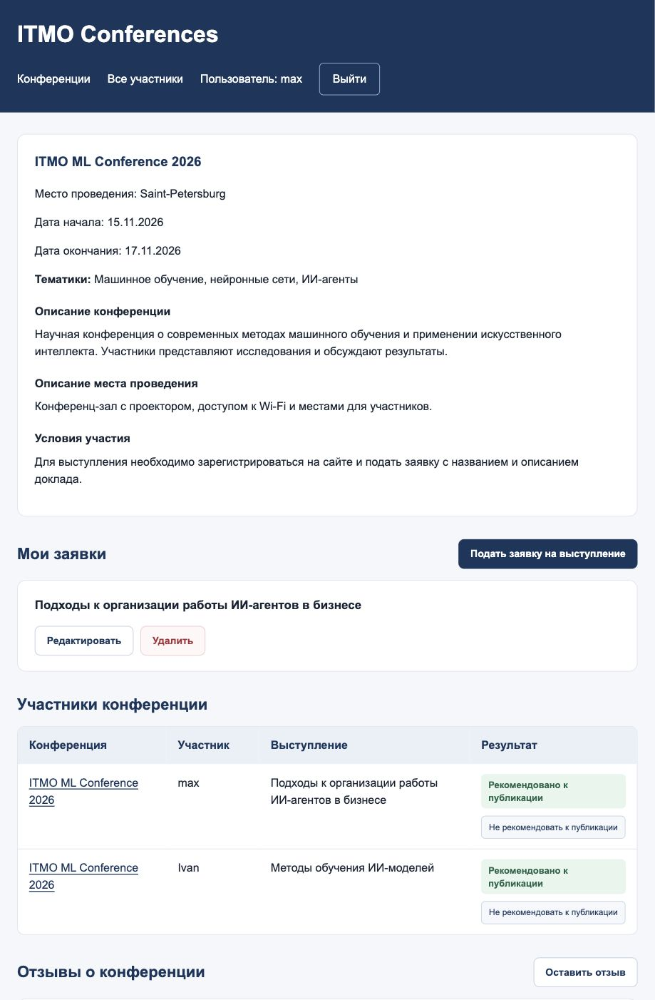

*Рисунок 2. Страница конференции: описание, личная заявка и участники.*

### Регистрация, вход и выход

Адреса: `/conferences/register/`, `/conferences/login/`, `/conferences/logout/`.

После успешной регистрации выполняется автоматический вход. Для входа и выхода используются встроенные `LoginView` и `LogoutView`. Выход выполняется через форму методом POST. Настройка `LOGIN_URL = "login"` обеспечивает перенаправление гостя с защищённого действия на существующую страницу входа.

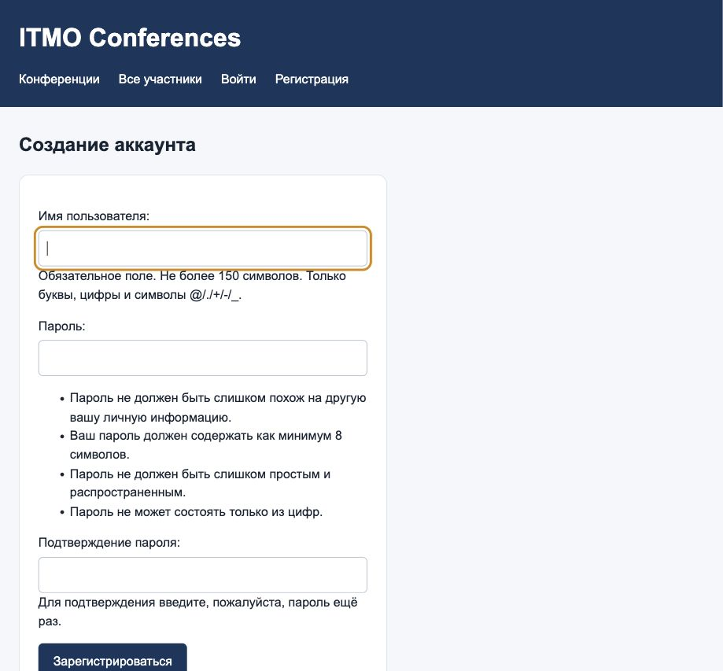

*Рисунок 3. Форма создания аккаунта.*

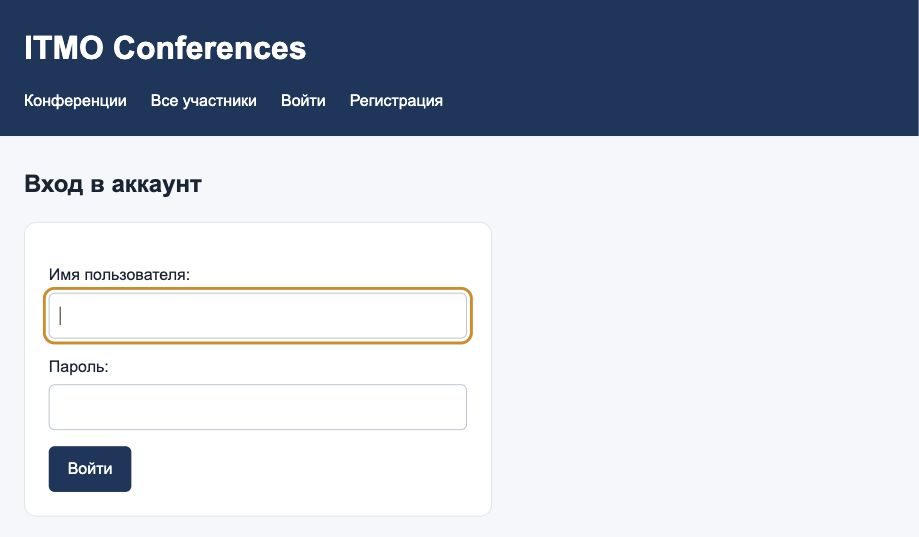

*Рисунок 4. Форма входа в систему.*

### Подача и изменение заявки

Адрес подачи: `/conferences/<id>/apply/`. После входа пользователь вводит название доклада и его описание.

Редактирование: `/conferences/applications/<id>/edit/`. Выборка ограничена текущим автором:

```python
application = get_object_or_404(
    Registration, id=application_id, user=request.user
)
```

Таким образом, изменение чужой заявки запрещено даже при ручном вводе адреса. В форму редактирования передаётся `instance=application`, поэтому меняется существующая запись.

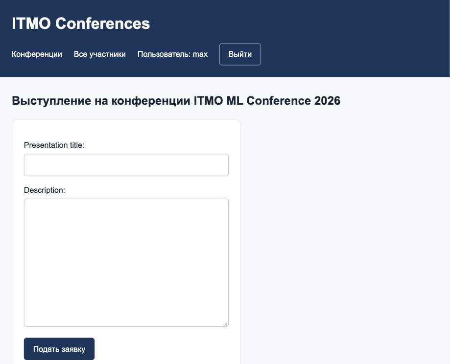

*Рисунок 5. Форма подачи заявки на выступление.*

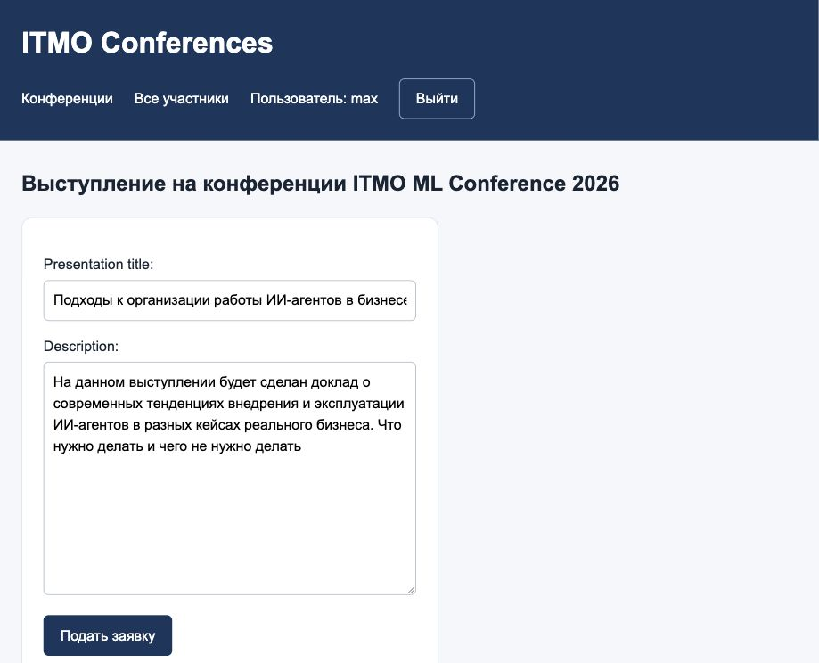

*Рисунок 6. Редактирование собственной заявки.*

### Удаление заявки

Адрес: `/conferences/applications/<id>/delete/`. На GET отображается подтверждение. Удаление выполняется только после POST и только для собственной заявки. Обычный переход по ссылке не удаляет запись.

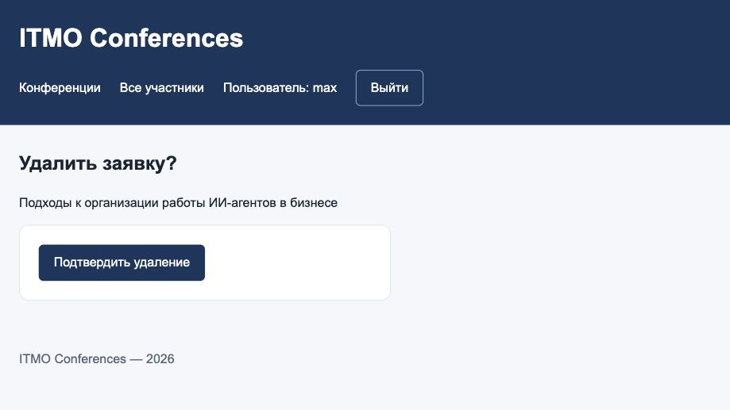

*Рисунок 7. Подтверждение удаления собственной заявки.*

### Отзывы

Адрес формы: `/conferences/<id>/review/`. Зарегистрированный пользователь вводит текст и оценку. Значения за пределами 1–10 отклоняются формой. На странице конференции отображаются автор, сохранённый период конференции, оценка, текст и время создания. Отзывы отсортированы от новых к старым.

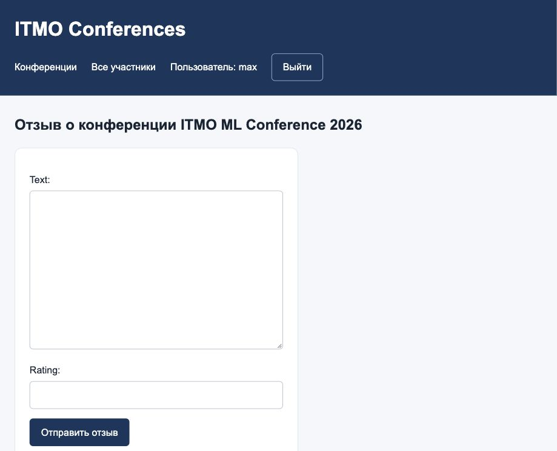

*Рисунок 8. Форма добавления отзыва с оценкой.*

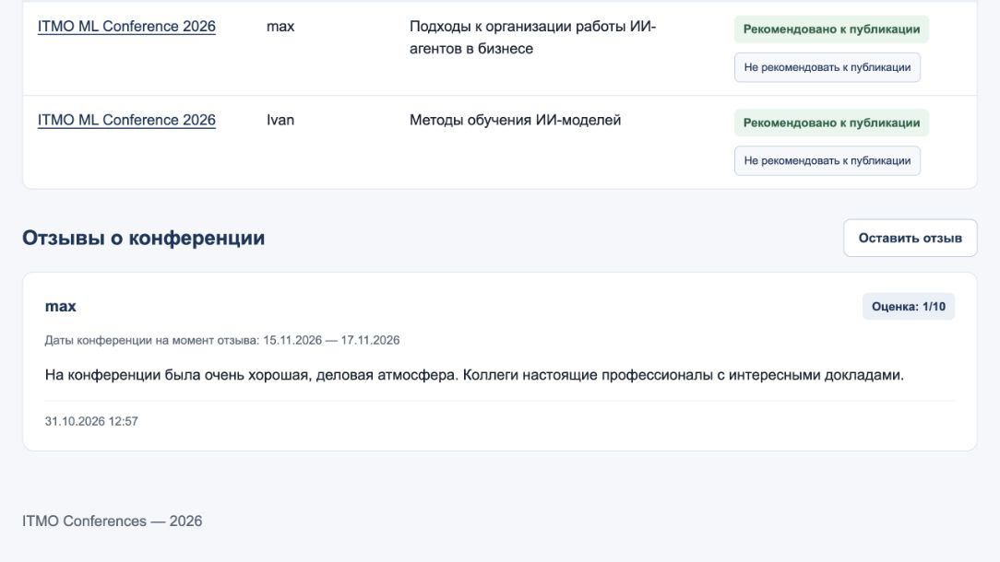

*Рисунок 9. Отзыв с автором, оценкой и сохранёнными датами конференции.*

### Общая таблица участников

Адрес: `/conferences/participants/`. Представление `participant_list` показывает все заявки с названием конференции, именем автора, названием доклада и результатом выступления. Записи упорядочены по конференциям и участникам. Каждая строка соответствует выступлению, поэтому автор с несколькими докладами может встретиться несколько раз.

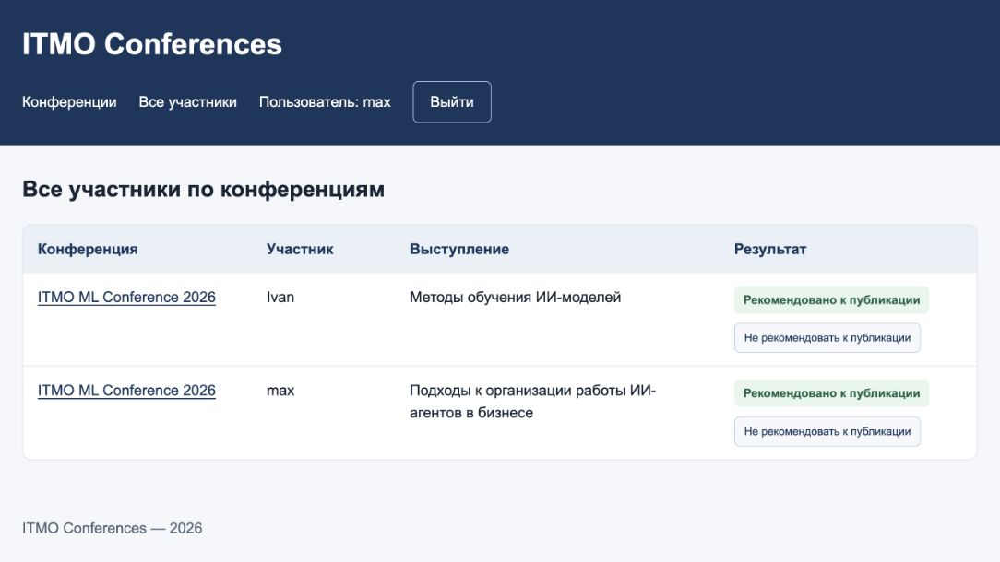

*Рисунок 10. Общая таблица участников и действия администратора на сайте.*

### Управление результатами выступлений

В Django Admin для заявок настроены список, поиск, фильтрация и редактирование `recommended` прямо в списке.

На сайте staff/superuser видит кнопки рекомендации к публикации. POST отправляется на `/conferences/applications/<id>/recommendation/`. Обработчик `set_recommendation` проверяет авторизацию, роль, метод запроса и допустимость значения `true`/`false`. Применён `require_POST`; обычный пользователь получает 403 при попытке модерации.

В Django Admin также доступны конференции и отзывы. Даты отзыва отображаются как поля только для чтения.

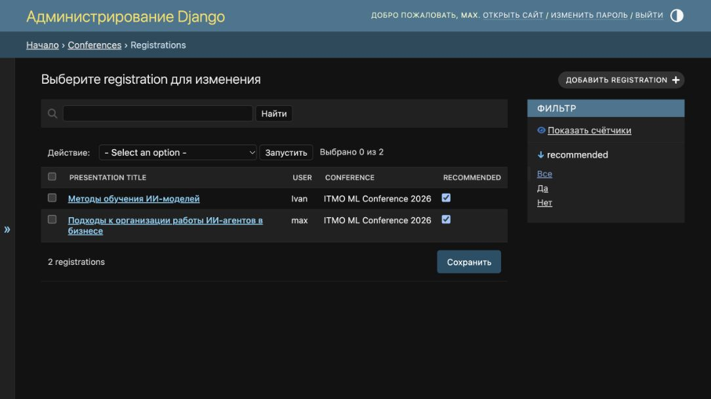

*Рисунок 11. Изменение рекомендаций к публикации в Django Admin.*

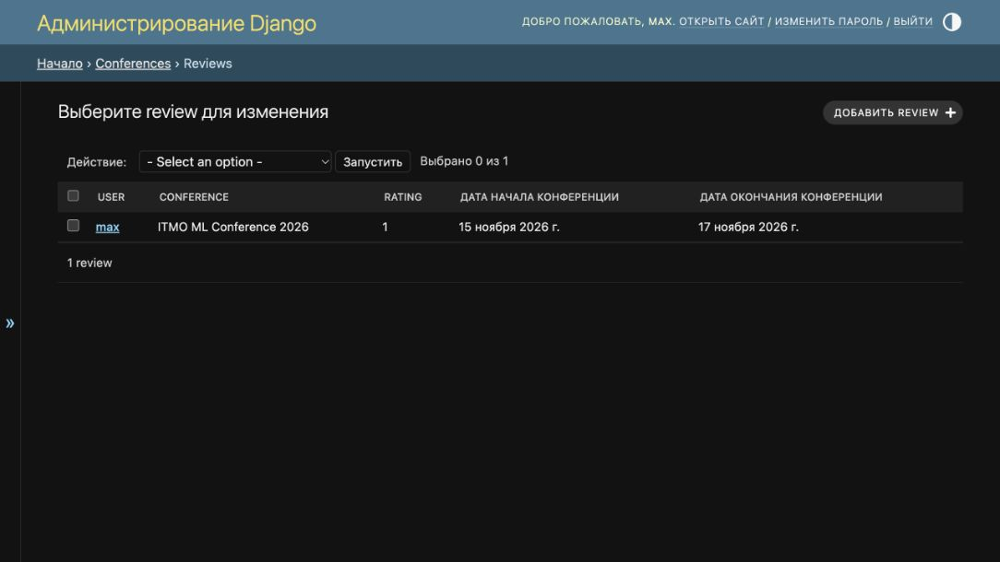

*Рисунок 12. Отзывы и сохранённые даты конференций в Django Admin.*

## Права доступа

| Действие | Гость | Пользователь | Администратор сайта |
|---|---|---|---|
| Просмотреть каталог, конференции, участников и отзывы | Да | Да | Да |
| Создать аккаунт и войти | Да | Да | Да |
| Подать заявку и написать отзыв | Требуется вход | Да | Да |
| Изменить или удалить свою заявку | Требуется вход | Да | Да |
| Изменить или удалить чужую заявку через пользовательскую форму | Нет | Нет | Нет |
| Менять рекомендацию к публикации на сайте | Нет | Нет | Да, staff/superuser |
| Управлять записями через Django Admin | Нет | Нет | Staff с разрешениями либо superuser |

Скрытие кнопок в шаблоне используется для отображения доступных действий. Защита дополнительно реализована в серверных представлениях. POST-формы содержат CSRF-токены.

## Комментарии в исходном коде

Классам и функциям добавлены русскоязычные строки документации, которые описывают их назначение. Комментарии объясняют проверки автора заявки, заполнение серверных полей, объединение условий поиска, сохранение периода отзыва и проверку результата модерации.

Тестовые методы также снабжены описаниями сценариев. Обновление комментариев не изменяет выполняемую логику; это проверено сравнением синтаксических деревьев Python без строк документации.

## Проверка работоспособности

В приложении реализовано **17 автоматических тестов**.

| Группа проверок | Проверяемое поведение |
|---|---|
| Авторизация | Регистрация, автоматический вход, выход, повторный вход, перенаправление гостя |
| Владение заявкой | Изменение своей заявки, запрет GET/POST к чужой заявке |
| Защита полей | Нельзя подменить автора, рекомендацию или даты отзыва через пользовательскую форму |
| Удаление | GET только показывает подтверждение, POST удаляет |
| Оценки | 0 и 11 отклоняются, 1 и 10 принимаются |
| Страницы | Вывод описаний, таблица участников, поиск и пагинация |
| Модерация | Ограничение staff/superuser, запрет GET, проверка входных значений, оба результата |
| CSRF | Изменяющие запросы без токена отклоняются |
| Снимок периода | Копирование дат, неизменность старых дат и новые даты для новых отзывов |
| Перенос данных | Миграция сохраняет текст, автора и оценку существующего отзыва и заполняет даты |

После добавления комментариев все 17 тестов успешно выполнены на временной SQLite. При проверке применяются все миграции приложения, включая отдельный сценарий перехода с `0004` на `0005`.

В рабочей PostgreSQL ранее применена миграция `0005`; проверены заполнение дат и сохранность существующего отзыва. Итоговая проверка PostgreSQL после документирования приведена ниже.

Итоговая проверка: **17 из 17 тестов прошли на отдельной PostgreSQL-базе**. Тестовая база создана с уникальным именем и удалена после завершения. Сценарий миграции старого отзыва также выполнен на PostgreSQL. Количество конференций, заявок и отзывов в рабочей базе до и после проверки совпадает.

Результат запуска:

```text
Ran 17 tests
OK
System check identified no issues (0 silenced).
```

### Команды проверки в окружении проекта

Из папки с `manage.py` после активации окружения:

```sh
python manage.py check
python manage.py makemigrations --check --dry-run
python manage.py showmigrations conferences
python manage.py test conferences --verbosity=2
```

Последняя команда использует отдельную тестовую базу PostgreSQL. Учётной записи СУБД нужны права для её создания. Рабочая база не является тестовой базой.

## Запуск приложения и отчёта

В папке `django_lab2` активировать существующее окружение и перейти к `manage.py`:

```sh
source .venv/bin/activate
cd conferences_webapp
```

Файл `.env` рядом с `manage.py` содержит локальные параметры подключения `DB_NAME`, `DB_USER`, `DB_PASSWORD`, `DB_HOST` и `DB_PORT`. Секретные значения в отчёт не включаются.

Подготовка базы и запуск:

```sh
python manage.py migrate
python manage.py createsuperuser
python manage.py runserver
```

Создавать суперпользователя нужно при первоначальной настройке. Каталог доступен по адресу `http://127.0.0.1:8000/conferences/`, административная панель — `http://127.0.0.1:8000/admin/`.

Для сборки отчёта из корня репозитория в окружении с установленными MkDocs и темой Material:

```sh
mkdocs build --strict
mkdocs serve
```

Страница отчёта включена в раздел «ЛР2» навигации сайта документации.

## Вывод

Реализовано приложение варианта №5: каталог научных конференций, регистрация пользователей, управление собственными заявками, отзывы с оценками и сохранёнными датами, результаты выступлений и таблица участников. Серверные проверки разграничивают доступ пользователей и администраторов. Поиск, пагинация и CSS-оформление обеспечивают работу с каталогом и таблицами. Автоматические тесты проверяют основные сценарии, права доступа и миграцию данных.
